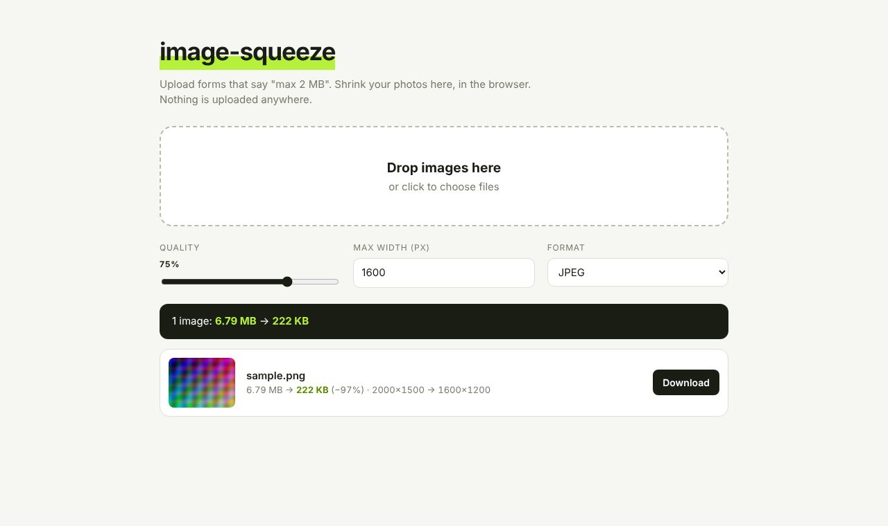

# image-squeeze

Upload forms with a size limit are annoying. Shrink photos here, in the browser. Nothing leaves your device.

**Live:** https://sammy1-com.github.io/image-squeeze/

Plain HTML, CSS and JS. Open `index.html`, no build step.

Resizes and re-encodes with a canvas as JPEG, WebP or PNG. Changing a setting re-runs it on the files you already picked.
